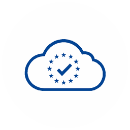

# VIESAC for Cursor



VAT/GST and EORI checks, VAT rates and compliance audit evidence in Cursor.
VIESAC is operated by Comet Group OÜ and connects to EU VIES and supported
national registries. Coverage varies by country and tool; see
[supported countries](https://viesac.eu/countries).

## Connect

Install this plugin in Cursor, then connect **viesac** when prompted. Sign in
on viesac.eu, choose your organization and review the requested permissions.
Never paste a password, API key or token into a conversation.

You can also add this remote server in Cursor's MCP settings:

```json
{
  "mcpServers": {
    "viesac": {"url": "https://mcp.viesac.eu/mcp"}
  }
}
```

Cursor discovers the OAuth sign-in automatically. No local server, Node.js
installation or manually copied API key is required. To disconnect, remove
the MCP server in Cursor and revoke its connection in your VIESAC API keys page.

## Try it

- “Check whether VAT DE129274202 is valid. Do not create an audit.”
- “Show my VIESAC plan and remaining audit credits.”
- “Find my organization's five latest audits.”
- “What VAT rates are available for Germany?”
- “Create one VAT audit for DE129274202 and show its reference and evidence.”

Quick validation does not create an audit or return company details.
Audit history and counterparty searches cover your connected organization's
records. They are not a worldwide company directory. An unavailable registry
is not evidence that an identifier is invalid.

## Account, permissions and credits

The plugin package is free and open source. A VIESAC account is required;
VIESAC service plans, limits and audit credits apply. Purchases take place
only on [viesac.eu](https://viesac.eu), outside Cursor.

`viesac:read` permits quick checks, rates, quota and your organization's audit
history. `viesac:audit` additionally permits creating audits. A VAT or EORI
audit uses one existing account credit; a combined VAT/EORI audit uses two.
Monitoring, when explicitly requested, creates further audits on its schedule.
Certificate availability depends on the plan and audit result. Check the
connected account and quota before requesting multiple audits.

## Privacy and support

Tool calls send the supplied identifiers and requested audit details to VIESAC.
VIESAC processes requests for the organization selected during OAuth consent;
checks and usage are logged to that account. Avoid including unrelated personal
or confidential information in prompts.

- [Privacy policy](https://viesac.eu/privacy-policy)
- [Terms](https://viesac.eu/terms-of-service)
- [API documentation](https://viesac.eu/api-docs)
- [Support](mailto:support@viesac.eu)

VIESAC is an independent service. It does not file tax returns, purchase credits
inside Cursor or guarantee legal acceptance of evidence. Registry results and
source availability should be assessed in the context of your compliance process.

## What this repository contains

Only the plugin manifest, public MCP endpoint, usage instructions, logo and MIT
license. It contains no VIESAC application/server source, credentials, API keys,
customer records, development server configuration or private infrastructure.
The license covers this package; the hosted VIESAC service has its own terms.
